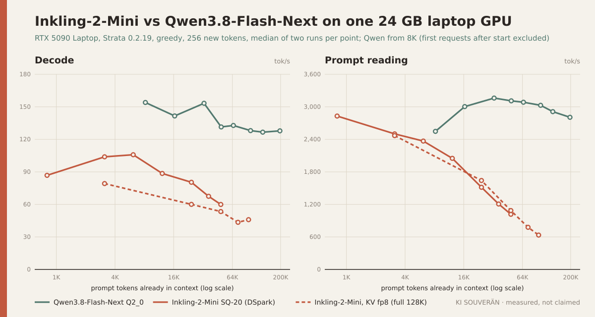
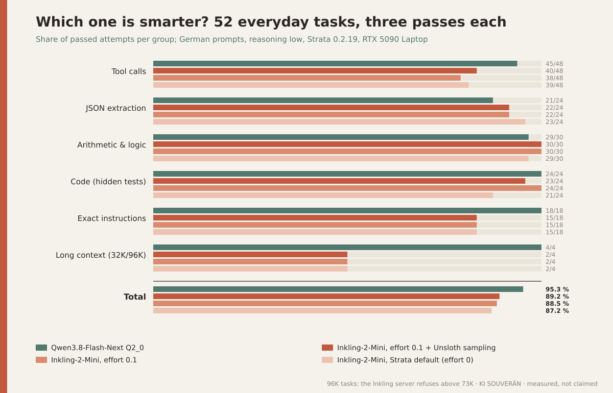

# Inkling-2-Mini vs Qwen3.8-Flash-Next on one 24 GB laptop GPU (2026-11-23)

[← all benchmarks](../README.md) · [Deutsch](../README.de.md)

Both models measured on the same evening, on the same laptop, with the same Strata build (0.2.19, built from source).
The full reports with raw data, configurations, logs and scripts are in our Strata fork and submitted upstream:

| Report | Branch with all files | Pull request |
| --- | --- | --- |
| Inkling-2-Mini SQ-20 | [bench-rtx-5090-laptop-inkling-2-mini](https://github.com/wolffahrer/Strata/tree/bench-rtx-5090-laptop-inkling-2-mini/docs/bench-results/2026-11-23-community-rtx-5090-laptop-inkling-2-mini-sq20) | [Niko1221/Strata#6906](https://github.com/Niko1221/Strata/pull/6906) |
| Qwen3.8-Flash-Next Q2_0, 0.2.19 | [bench-rtx-5090-laptop-0.2.19](https://github.com/wolffahrer/Strata/tree/bench-rtx-5090-laptop-0.2.19/docs/bench-results/2026-11-23-community-rtx-5090-laptop-engine-0.2.19) | [Niko1221/Strata#6907](https://github.com/Niko1221/Strata/pull/6907) |

## Speed over context

- **Qwen** stays flat: 127–154 tok/s decode and 2,800–3,160 tok/s prompt reading from 8K to 196K tokens.
- **Inkling** is quick on short prompts (2,830 tok/s prompt, up to 106 tok/s decode) and slows down steadily with
  context: 60 tok/s decode and 1,018 tok/s prompt at 49K. With FP16 KV the engine caps the context at 73,280 tokens;
  `--kv fp8` gives the full 131,072 at 11–23 % less decode speed.
- The DSpark drafter is worth 29–43 % decode for Inkling (greedy). Keep it on.

## Which one is smarter?

Our private 52-task suite (German prompts), three passes each. Qwen: **95.3 %**. Inkling: 87.2 % with Strata's
default thinking effort 0, 88.5 % at effort 0.1, **89.2 %** at effort 0.1 with temperature 1. Inkling won JSON
extraction and arithmetic and passed the public coding check 10/10 (Qwen 6/10 that run); Qwen was clearly better at
tool calls and following exact instructions. Two Inkling misses per pass are 96K tasks it cannot take with FP16 KV.

## What surprised us

1. Inkling writes a thinking span even when thinking is switched off; Strata drops it from the answer. With small
   token limits you get empty replies, which also breaks Strata's own quick benchmark and its needle test.
2. `"drafting": "off"` in the Strata config does not switch the drafter off; `--draft off` does.
3. `--kv k8v8` crashed the engine on our card; `--kv fp8` works.
4. Inkling fits fully in VRAM: 15 GiB host RAM in use for the whole system, against 57 GiB with Qwen.

Machine: Schenker XMG NEO 16 (A25), RTX 5090 Laptop GPU 24 GB, Ryzen 9 9955HX3D, 64 GB RAM, Windows 11, fastest
power profile. Charts as PNG: [context sweep](../assets/inkling-vs-qwen-context-sweep.png),
[quality](../assets/quality-52-tasks.png); German versions in [assets](../assets/).
