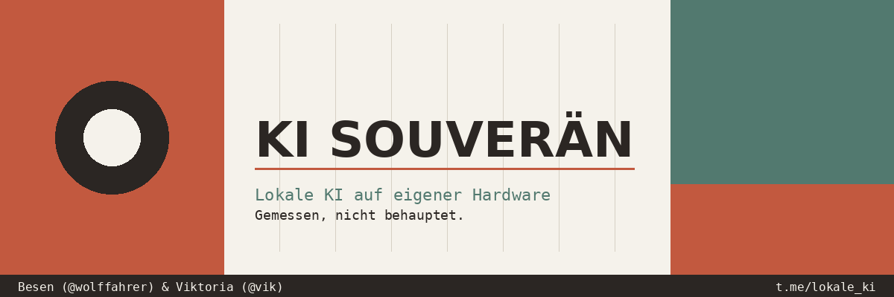
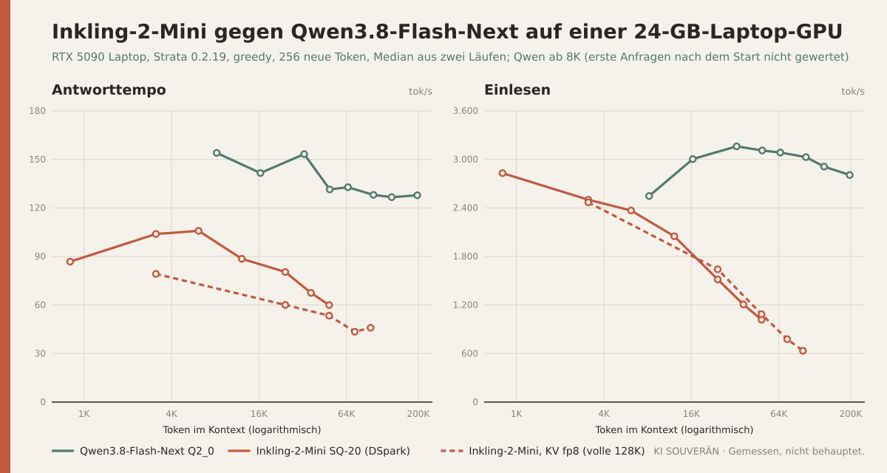
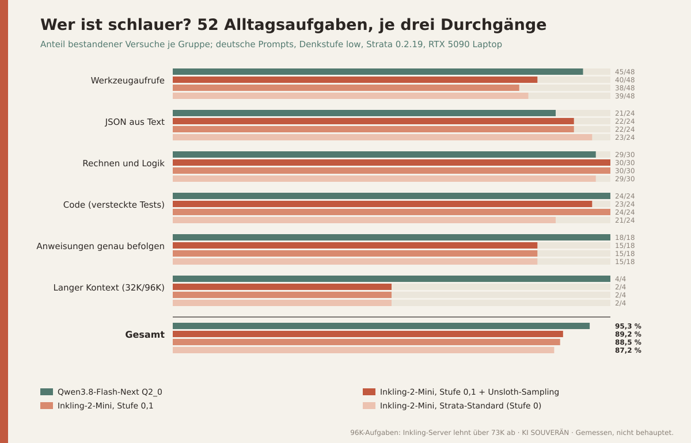

[English](README.md) | **Deutsch**

# Lokale KI-Benchmarks auf einem Gaming-Laptop

Messungen offener Modelle auf normaler Hardware, mit Rohdaten, Skripten und den Fehlschlägen. Eine Maschine, dieselben
Skripte über alle Versionen, für jeden Test ein frisch gestarteter Server. Die Zahlen stammen aus eigenen Läufen;
Herstellerangaben stehen nur da, wo sie als solche gekennzeichnet sind.

**Maschine:** Schenker XMG NEO 16 (A25), NVIDIA RTX 5090 Laptop-GPU 24 GB (175 W Dynamic Boost), Ryzen 9 9955HX3D,
64 GB RAM, Windows 11. **Engine:** [Strata](https://github.com/Niko1221/Strata), selbst aus dem Quellcode gebaut.

## Neu: Inkling-2-Mini gegen Qwen3.8-Flash-Next (23.11.2026)

| | Inkling-2-Mini SQ-20 | Qwen3.8-Flash-Next Q2_0 |
| --- | ---: | ---: |
| Antworttempo, kurzer Kontext | ~104 t/s (DSpark an) | ~141–154 t/s |
| Antworttempo, langer Kontext | 60 t/s bei 49K | 127 t/s bei 196K |
| Einlesen, kurz → lang | 2.830 → 1.018 t/s | 2.000 → 3.300 t/s, danach flach |
| Größter Kontext | 73K mit FP16-KV, 131K mit `--kv fp8` | 262K |
| RAM-Spitze (ganzes System) | 15 GiB | 57 GiB |
| Nadeltest | 6/6 bis 64K | 6/6 bis 128K |
| Code-Test (10 versteckte Tests) | 10/10 | 6/10 |
| Unser 52-Aufgaben-Test (3 Durchgänge) | 87–89 % | **95 %** |

**In einem Satz:** Qwen ist auf diesem Laptop schneller und gewinnt unseren Alltagstest mit rund fünf Punkten;
Inkling passt komplett in den Grafikspeicher, braucht ein Viertel des Arbeitsspeichers, gewann beim JSON-Auszug und bestand den öffentlichen
Code-Test mit 10/10.

Einzelheiten, Rohdaten und die Fehler, auf die wir gestoßen sind:
[2026-11-23-inkling-2-mini-vs-qwen3.8-flash-next](2026-11-23-inkling-2-mini-vs-qwen3.8-flash-next/README.md).

## Qwen3.8-Flash-Next Q2_0 über die Strata-Versionen

Derselbe Laptop, dieselben Modelldateien, dieselbe Reihen-Konfiguration und dasselbe Skript (Median Antwort- /
Einlesetempo in t/s):

| Prompt-Token | 0.1.40.1 (06.10.2026) | 0.1.40.3 (08.10.2026) | 0.2.19 (23.11.2026) |
| ---: | ---: | ---: | ---: |
| 4.096 | 136,9 / 1.952,5 | 138,1 / 1.949,7 | 141,4 / 2.000,1 |
| 32.768 | 137,7 / 2.877,8 | 144,4 / 2.893,3 | 142,7 / 3.338,2 |
| 128.000 | 134,6 / 2.764,1 | 131,0 / 2.780,1 | 136,2 / 3.330,3 |

Die beiden Oktober-Einträge hat Strata ins eigene Repository übernommen:
[0.1.40.1](https://github.com/Niko1221/Strata/tree/main/docs/bench-results/2026-10-06-community-rtx-5090-laptop),
[0.1.40.3](https://github.com/Niko1221/Strata/tree/main/docs/bench-results/2026-10-08-community-rtx-5090-laptop-engine-0.1.40.3).

## So messen wir

- Frischer Server pro Test, greedy, feste Token-Grenzen, Zeiten der Engine (nicht Token geteilt durch Wandzeit).
- Fehlgeschlagene Anfragen bleiben in den Daten und werden im Bericht genannt.
- Unser 52-Aufgaben-Test (Werkzeugaufrufe, JSON aus Text, Rechnen und Logik, Code mit versteckten Tests, genaue
  Anweisungen, langer Kontext) hat deutsche Prompts und bleibt privat, damit niemand ein Modell darauf trimmen kann.
  Wir veröffentlichen die Ergebnisse, nicht die Aufgaben.

## Kanal

Wir dokumentieren lokale KI auf normaler Hardware, mit den Messungen hinter jeder Aussage.

- YouTube: [@KISouverän](https://www.youtube.com/@KISouver%C3%A4n)
- Telegram: [t.me/lokale_ki](https://t.me/lokale_ki)

Daten und Berichte: CC BY 4.0. Skripte: MIT. Siehe [LICENSE](LICENSE).
