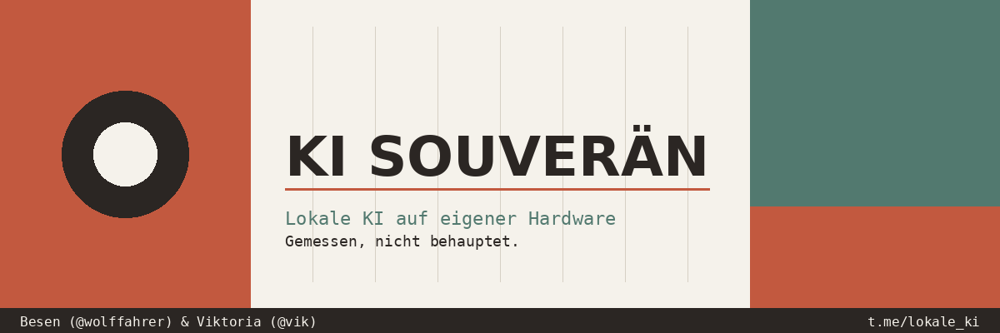
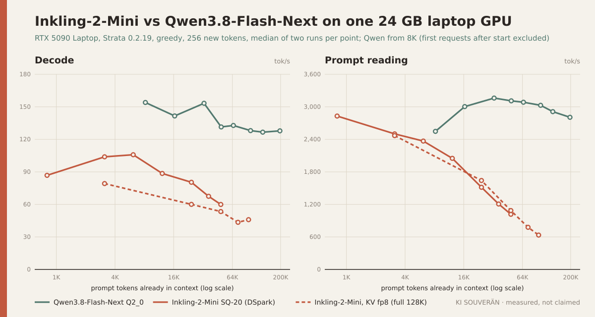
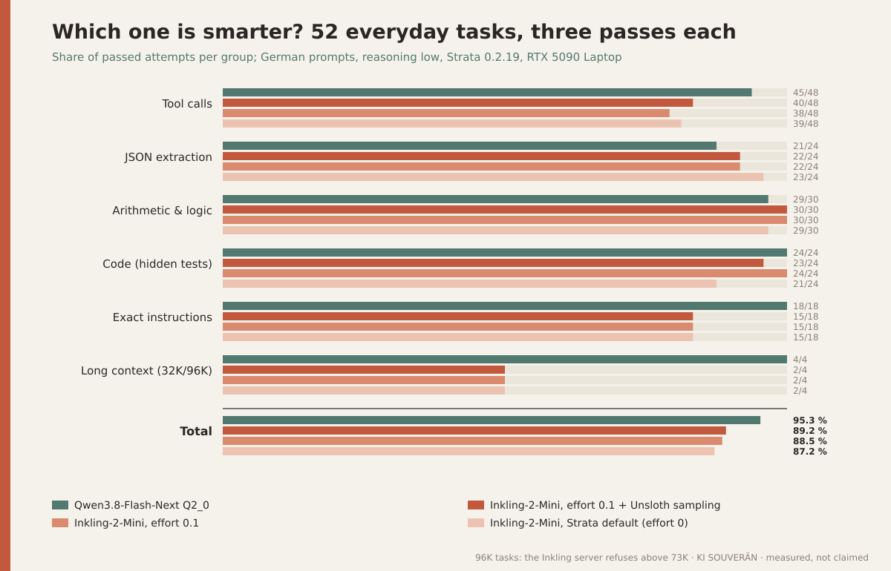

**English** | [Deutsch](README.de.md)

# Local AI benchmarks on one gaming laptop

Measurements of open-weight models on consumer hardware, with raw data, scripts and the failures included.
One machine, the same scripts across versions, fresh server for every test. The numbers come from our own runs;
vendor figures are only quoted where they are labelled as such.

**Machine:** Schenker XMG NEO 16 (A25), NVIDIA RTX 5090 Laptop GPU 24 GB (175 W Dynamic Boost), Ryzen 9 9955HX3D,
64 GB RAM, Windows 11. **Engine:** [Strata](https://github.com/Niko1221/Strata), built from source.

## Latest: Inkling-2-Mini vs Qwen3.8-Flash-Next (2026-11-23)

| | Inkling-2-Mini SQ-20 | Qwen3.8-Flash-Next Q2_0 |
| --- | ---: | ---: |
| Decode, short context | ~104 tok/s (DSpark on) | ~141–154 tok/s |
| Decode, long context | 60 tok/s at 49K | 127 tok/s at 196K |
| Prompt reading, short → long | 2,830 → 1,018 tok/s | 2,000 → 3,300 tok/s, then flat |
| Largest context | 73K with FP16 KV, 131K with `--kv fp8` | 262K |
| Host RAM peak (system-wide) | 15 GiB | 57 GiB |
| Needle recall | 6/6 up to 64K | 6/6 up to 128K |
| Coding check (10 hidden tests) | 10/10 | 6/10 |
| Our 52-task suite (3 passes) | 87–89 % | **95 %** |

**In one sentence:** Qwen is faster on this laptop and won our everyday task suite by about five points; Inkling
fits fully in VRAM, needs a quarter of the host RAM, won JSON extraction and passed the public coding check 10/10.

Details, raw data and the issues we ran into: [2026-11-23-inkling-2-mini-vs-qwen3.8-flash-next](2026-11-23-inkling-2-mini-vs-qwen3.8-flash-next/README.md).

## Qwen3.8-Flash-Next Q2_0 across Strata versions

Same laptop, same model files, same series configuration and script (median decode / prompt tok/s):

| Prompt tokens | 0.1.40.1 (2026-10-06) | 0.1.40.3 (2026-10-08) | 0.2.19 (2026-11-23) |
| ---: | ---: | ---: | ---: |
| 4,096 | 136.9 / 1,952.5 | 138.1 / 1,949.7 | 141.4 / 2,000.1 |
| 32,768 | 137.7 / 2,877.8 | 144.4 / 2,893.3 | 142.7 / 3,338.2 |
| 128,000 | 134.6 / 2,764.1 | 131.0 / 2,780.1 | 136.2 / 3,330.3 |

The two October entries were taken into the Strata repository:
[0.1.40.1](https://github.com/Niko1221/Strata/tree/main/docs/bench-results/2026-10-06-community-rtx-5090-laptop),
[0.1.40.3](https://github.com/Niko1221/Strata/tree/main/docs/bench-results/2026-10-08-community-rtx-5090-laptop-engine-0.1.40.3).

## How we measure

- Fresh server per test, greedy decoding, fixed output caps, engine timings (not tokens divided by wall time).
- Failed requests stay in the data and are named in the report.
- Our 52-task suite (tool calls, JSON extraction, arithmetic and logic, code with hidden tests, exact instruction
  following, long context) uses German prompts and is private, so models cannot be tuned to it. We publish the scores,
  not the tasks.

## Channel

We document local AI on consumer hardware in German, with the measurements behind every claim.

- YouTube: [@KISouverän](https://www.youtube.com/@KISouver%C3%A4n)
- Telegram: [t.me/lokale_ki](https://t.me/lokale_ki)

Data and reports: CC BY 4.0. Scripts: MIT. See [LICENSE](LICENSE).
